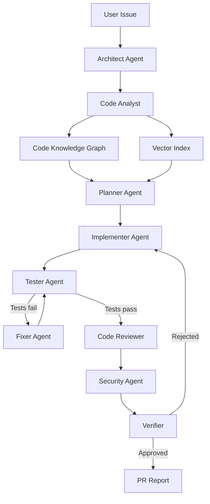

# AgentForge

> New here? Follow [SETUP.md](SETUP.md) to get it running. Engineering notes (review, architecture, testing, operations) are in [docs/ENGINEERING.md](docs/ENGINEERING.md).

> An autonomous multi-agent software engineering system that understands, modifies, tests, critiques, and secures real codebases.

AgentForge ingests a repository, builds a **code knowledge graph** from it, and then hands a software engineering task to a team of nine specialised agents. They plan the change, write it, run the real test suite, diagnose real failures, repair them, review the diff, scan it for security problems, and issue a verdict — ending in a pull-request-style report.

Every number the system reports is computed from actual state: parsed symbols, graph queries, tool-call journals, workspace diffs, and parsed test output. There is no simulated agent chatter anywhere in this repository.

```
        NORMAL CODING ASSISTANT                    AGENTFORGE

              Question                                 Issue
                 │                                       │
                 ▼                            Repository understanding
                LLM                                      │
                 │                              Code knowledge graph
                 ▼                                       │
                Code                                  Planning
                                                         │
                                              Tool-using agents
                                                         │
                                            Real code modification
                                                         │
                                                Test execution
                                                         │
                                               Self-correction
                                                         │
                                        Code review → Security review
                                                         │
                                            Verification → PR report
```

---

## Demo

```bash
# 1. Run a real task against the bundled sample repository — no API key needed
python scripts/run_task.py sample_repo \
  "Add JWT authentication to the user API and protect the /users endpoints." --diff
```

Abbreviated output from an actual run:

```
Ingested sample_repo: 17 files, 15 parsed, 106 graph nodes, 199 edges, 60 vector chunks

▸ architect      FastAPI + Pydantic; 6 modules likely affected
  → architect    Architecture identified as FastAPI + Pydantic
▸ analyst        5 target files, 3 covering tests
▸ planner        7-step plan (jwt_auth)
▸ implementer    7 files changed, 0 steps skipped
▸ tester         22 passed, 0 failed of 25
▸ reviewer       approved, 4 findings
▸ security       pass (0 findings)
▸ verifier       approved: 7/7 steps, tests passed

--- CHANGES ---
  A app/core/security.py        A app/services/credentials.py
  A app/api_dependencies.py     A app/routes/auth.py
  M app/routes/users.py         M app/main.py
  A tests/test_auth.py
```

The test suite grew from 17 to 25 tests because the agents wrote and ran new ones.

### The self-correction loop

```bash
python scripts/inject_bug.py        # drops one import from the sample repo
python scripts/run_task.py sample_repo_buggy \
  "Find and fix the bug that makes the user service tests fail."
```

```
Tests executed  17 collected | 12 passed | 2 failed     ← NameError: clamp_page_size
  → fixer       Repaired name_error in app/services/users.py
Tests executed  17 collected | 14 passed | 0 failed
  → verifier    Verification approved
```

The Fixer does not guess. It parses the traceback, finds the deepest frame that belongs to the repository (not the standard library, not the test file), looks the missing symbol up in the **symbol index**, resolves the module that defines it, and edits the existing import line. That is the knowledge graph doing work keyword search cannot.

---

## Architecture



```
agentforge/
├── backend/app/
│   ├── codebase/      scanner · parser (stdlib ast) · symbols · dependencies
│   ├── graph/         model · store (memory) · neo4j_client · builder · queries · traversal
│   ├── retrieval/     embeddings · chunking · vector_store · text_search · hybrid_search
│   ├── tools/         base (permissions) · filesystem · code_search · graph_tools
│   │                  · test_runner · git · sandbox
│   ├── llm/           provider · client · prompts · recipes · templates
│   ├── agents/        base · architect · analyst · planner · implementer · tester
│   │                  · fixer · diagnosis · reviewer · review_checks · security
│   │                  · security_checks · verifier
│   ├── orchestration/ state · events · workspace · repository · graph (state machine)
│   │                  · runner · report
│   └── api/           repositories · tasks · graph · events · state
├── frontend/          Next.js 14 · TypeScript · Tailwind · React Flow · Monaco
├── sample_repo/       a small FastAPI service with no authentication
├── scripts/           run_task.py (headless runner) · inject_bug.py
└── docs/              security-model.md
```

**The engine core depends only on the Python standard library.** FastAPI, Neo4j, ChromaDB, Docker and the LLM provider are all optional adapters selected by environment variable. This is a deliberate design decision, not a shortcut: it means the scanner, parser, graph, retrieval, tools, agents and orchestrator are all testable in a bare environment, and the whole pipeline degrades to something honest rather than something broken when a service is missing.

---

## Code Knowledge Graph

Python is parsed with the standard library `ast`, so extraction is exact rather than heuristic. JavaScript and TypeScript use a small scanner behind the same `LanguageParser` protocol — that protocol is the extension point where tree-sitter or a full grammar slots in.

**Node types:** `Repository · Directory · File · Module · Class · Function · Method · Test · Dependency · APIEndpoint · Configuration · ExternalService`

**Edge types:** `CONTAINS · DEFINES · IMPORTS · CALLS · INHERITS · TESTS · DEPENDS_ON · REFERENCES · EXPOSES · USES · CONFIGURES`

Every edge is derived from static analysis. The single exception is `Dependency --USES--> ExternalService`, which comes from an explicit, reviewable table in `graph/builder.py` (`psycopg2 → PostgreSQL`, `redis → Redis`, and so on). Nothing in the graph is inferred by a language model.

Every code entity carries provenance, which is what lets the UI jump from a graph node to the exact lines:

```json
{
  "type": "Function",
  "name": "authenticate_user",
  "file": "app/auth.py",
  "line_start": 42,
  "line_end": 71
}
```

On the bundled sample repository this produces **106 nodes and 199 edges** from 17 files.

### Hybrid retrieval

A vector search answers "what looks similar". An agent needs "what will I have to touch". `retrieval/hybrid_search.py` fuses four signals and attaches the evidence for every ranked file:

| Signal | Weight | Source |
|---|---|---|
| Semantic similarity | 1.0 | cosine over code chunks |
| Symbol name match | 0.8 | graph node lookup, identifier-aware |
| Literal text match | 0.4 | in-memory grep |
| Graph expansion | 0.5 | CALLS / IMPORTS / TESTS / DEFINES traversal |

```
app/routes/users.py    score 3.41
  · semantic match on app.routes.users.list_users (score 0.44)
  · symbol name matches: list_users
  · graph: list_users calls UserService
```

The embedder is a deterministic hashed bag-of-tokens model with camelCase and snake_case shingling. It is weaker than a trained model and the README should say so plainly — but it is real vector search, it needs no download, and `VECTOR_BACKEND=chroma` swaps in a trained one.

### "Why does this file matter?"

`graph/traversal.py` computes the shortest path between two entities, so the system can justify relevance instead of asserting it:

```
tests/test_service.py
  --CONTAINS-->  tests
  --CONTAINS-->  app/service.py
  --IMPORTS-->   app/helpers.py
```

The UI highlights this path. It is the clearest single demonstration that AgentForge is not doing keyword search.

---

## Agents

Nine roles, each with a system prompt, structured input and output, and a tool belt restricted to what the role justifies.

| Agent | Responsibility | Produces |
|---|---|---|
| **Architect** | Frameworks, entry points, layering, structural risk | `ArchitectureReport` |
| **Code Analyst** | Where the change belongs, and the evidence for it | `AnalysisReport` |
| **Planner** | Ordered, file-scoped implementation plan | `Plan` of `PlanStep` |
| **Implementer** | The only agent that writes code | `FileChange` records |
| **Tester** | Detects the runner, executes it, parses real output | `TestReport` |
| **Fixer** | Diagnoses tracebacks, applies the minimal repair | `CodeEdit` |
| **Code Reviewer** | Correctness, scope, duplication, maintainability | `Finding[]` |
| **Security Reviewer** | Secrets, injection, auth, deserialisation, traversal | `SecurityReport` |
| **Verifier** | Final gate; approves or routes back to one agent | `Verification` |

Agents exchange typed structures through `orchestration/state.py`, not large free-text blobs. Each section records which agent produced it.

### Dual execution mode

Each agent has two paths, and the run reports which one it took:

- **With an LLM configured** (`LLM_PROVIDER=anthropic|openai`) the agent asks the model for structured JSON and validates it. The Analyst, for example, discards any file path the model invents that does not exist in the repository, and records that it did so.
- **Offline** (the default) the agent works from static analysis alone: real AST inspection, real graph queries, real detectors, and a bounded set of implementation recipes.

Offline mode is weaker and the system says so in `/api/health`. What it never does is fabricate. A deterministic agent that reports "no recipe matched this issue" is more useful in a portfolio than one that invents plausible-looking output.

---

## Tool Use

Agents never touch the repository directly. They call named tools:

```
read_file(path, start_line, end_line)     search_code(query, regex)
list_files(subdirectory)                  search_semantic(query)
get_symbol(name)                          list_symbols_in_file(path)
graph_search(name, node_type)             get_graph_neighbors(node, depth)
find_graph_path(source, target)           file_relevance_path(entry, target)
describe_symbol(name)                     list_endpoints() · list_dependencies()
write_file(path, content)                 apply_patch(path, old_text, new_text)
insert_after(path, anchor, addition)      git_diff(path) · git_status()
detect_test_command()                     run_tests()
```

Every call is journalled — agent, tool, arguments, result, duration — which is where the tool-call metric comes from and what the live UI log renders.

### Tool permissions

`agents/base.py` holds the permission matrix, and it is enforced, not documented:

| Agent | read | search | graph | **write** | **execute** |
|---|:--:|:--:|:--:|:--:|:--:|
| Architect | ✓ | ✓ | ✓ | | |
| Analyst | ✓ | ✓ | ✓ | | |
| Planner | ✓ | ✓ | | | |
| **Implementer** | ✓ | ✓ | | **✓** | |
| **Tester** | ✓ | | | | **✓** |
| **Fixer** | ✓ | ✓ | | **✓** | |
| Reviewer | ✓ | ✓ | ✓ | | |
| Security | ✓ | ✓ | | | |
| Verifier | ✓ | ✓ | | | |

Calling anything outside the row raises `ToolPermissionError`. The test suite asserts that no read-only agent can reach a write tool, and that `run_tests` is granted to exactly one agent.

### Safe editing

The Implementer prefers targeted edits over rewrites. `apply_patch` refuses a snippet that appears zero times *or more than once*, so an ambiguous patch fails loudly instead of corrupting a file. Whole-file writes are reserved for new files. The workspace keeps the original content of every touched file and produces a genuine unified diff.

---

## Self-Correction Loop

```
Implement → Test → Failure → Diagnose → Fix → Retest
```

`agents/diagnosis.py` classifies a failure before anything is changed. It handles a deliberately small set of cases rather than guessing:

| Failure | Handling |
|---|---|
| `NameError` | Symbol exists elsewhere in the repo → add the import |
| `ImportError: cannot import name` | Symbol moved → correct the import path |
| `ModuleNotFoundError` | Reported with the missing module named |
| `SyntaxError` | Reported with file and line |
| `AssertionError` | Reported; behaviour changes are **not** auto-repaired |

Anything else is escalated to the LLM, or reported unrepaired. The loop is bounded by `MAX_FIX_ITERATIONS` (default 3) and the verifier loop by `MAX_VERIFY_ITERATIONS` (default 2). There is no path that can spin forever.

The Fixer is explicitly instructed never to weaken or delete a test to make it pass, and it has no tool that would let it delete one silently without the Reviewer's scope check noticing.

---

## Security

Two separate concerns: AgentForge reviewing *your* code, and AgentForge not being a liability itself. Full detail in [`docs/security-model.md`](docs/security-model.md).

### Reviewing your code

`agents/security_checks.py` runs AST-based detectors over the changed files: hard-coded secrets, weak password hashing, `eval`/`exec`, `os.system` and `shell=True`, unsafe deserialisation, SQL built by interpolation, permissive CORS, debug mode, TLS verification disabled, path traversal, and — for authentication tasks — whether tokens carry and enforce an `exp` claim and whether every route has an auth dependency.

Each finding names the construct it matched with a file and line, so a human can confirm it in seconds. When the detector was too eager during development (it flagged `SECRET_ENV_VAR = "JWT_SECRET_KEY"`, which names an environment variable rather than holding a secret), the fix was to tighten the rule and add a regression test, not to lower the severity.

### Not being a liability

- **Command allowlist.** Agents cannot construct a command string. They request a name from `ALLOWED_COMMANDS`; anything else raises `SandboxError`. Commands run with `shell=False`, arguments containing shell metacharacters are refused, and the working directory is confined to the workspace.
- **Scrubbed environment.** Child processes receive `PATH`, `HOME`, `LANG`, `TMPDIR` and `PYTHONPATH` only. Provider API keys never reach a test process — there is a test asserting exactly this.
- **Docker sandbox.** `SANDBOX_BACKEND=docker` runs the same allowlisted commands in a disposable container with `--network=none`, a memory cap and a PID limit.
- **Workspace isolation.** Your repository is never modified. Each run copies it, and a test asserts the original is untouched after a run that changed files.
- **Path traversal protection.** Every path resolves against the workspace root and is rejected if it escapes. The same check guards the repository file API and zip extraction (zip-slip, entry count and expanded-size limits).
- **Secrets are never indexed.** `.env`, `.env.*`, `*.pem`, `*.key`, `id_rsa*`, `credentials*` are skipped by the scanner and appear in `skipped` with the reason.
- **Limits everywhere.** File size, write size, command timeout, fix iterations, verify iterations, graph render caps.
- **No API keys in the frontend.** The browser talks only to the backend; provider keys live in the backend environment.
- **Nothing is ever pushed.** Git operations are local to the workspace copy.

---

## Installation

Requires Python 3.11+ and Node 20+.

```bash
git clone <your-fork-url> agentforge
cd agentforge

# Backend
cd backend
python -m venv .venv && source .venv/bin/activate    # Windows: .venv\Scripts\activate
pip install -r requirements.txt
cp .env.example .env
cd ..

# Frontend
cd frontend
npm install
cp .env.local.example .env.local
cd ..
```

Run it:

```bash
make run-api     # or: cd backend && uvicorn app.main:app --reload --port 8000
make run-ui      # or: cd frontend && npm run dev
```

Open <http://localhost:3000>, put `../sample_repo` in the repository field, press **Index**, pick a sample task, and press **Run agents**.

No UI needed:

```bash
make test        # 112 tests
make demo        # JWT task with the diff printed
make demo-bug    # the test → fix → retest loop
```

With Docker, including Neo4j:

```bash
docker compose up --build
```

---

## Configuration

Everything is environment-driven (`backend/.env.example`):

| Variable | Default | Notes |
|---|---|---|
| `LLM_PROVIDER` | `offline` | `offline` · `anthropic` · `openai` |
| `LLM_MODEL` | `claude-sonnet-4-5` | Provider model string |
| `LLM_API_KEY` | *(empty)* | Empty forces offline mode with a warning |
| `GRAPH_BACKEND` | `memory` | `memory` · `neo4j` — falls back with a warning |
| `NEO4J_URI` / `USER` / `PASSWORD` | `bolt://localhost:7687` | Used when `GRAPH_BACKEND=neo4j` |
| `VECTOR_BACKEND` | `memory` | `memory` · `chroma` |
| `SANDBOX_BACKEND` | `subprocess` | `subprocess` · `docker` |
| `MAX_FIX_ITERATIONS` | `3` | Bounds the test/fix loop |
| `MAX_VERIFY_ITERATIONS` | `2` | Bounds the verification loop |
| `COMMAND_TIMEOUT_SECONDS` | `120` | Per command |
| `MAX_FILE_BYTES` | `1000000` | Files above this are skipped |
| `APPROVAL_MODE` | `false` | Pause before any file is modified |

`GET /api/health` reports which adapters are live and warns about every degraded one, so the UI is never quietly less capable than it looks.

### Human approval mode

Set `APPROVAL_MODE=true`, or toggle **Approval mode** in the UI. The workflow pauses before the Implementer runs, emits an `approval_required` event listing the files the plan will touch, and waits for `POST /api/tasks/{run_id}/approval`. Auto mode is the default; the gate is a first-class part of the state machine, not a UI afterthought.

---

## Example

```
Issue:
  Add JWT authentication to the user API and protect the /users endpoints.

Result:
  7 files changed  (4 added, 2 modified, 1 test file added)
  25 tests collected, 22 passed, 0 failed   (suite grew from 17)
  Code review:     approved, 4 low-severity findings
  Security review: pass — 0 critical, 0 high, 0 medium, 0 low
  Verification:    approved — 7/7 plan steps, 69 tool calls
```

The generated token module implements HS256 against the standard library, reads its signing key from `JWT_SECRET_KEY` (raising a clear error when unset rather than falling back to a default), sets and enforces an `exp` claim, compares signatures with `hmac.compare_digest`, and hashes passwords with salted PBKDF2-SHA256. The security agent checks all of that and would fail the run if any were missing.

---

## API

| Method | Path | Purpose |
|---|---|---|
| `GET` | `/api/health` | Adapter status and honest warnings |
| `POST` | `/api/repositories` | Ingest a directory |
| `POST` | `/api/repositories/upload` | Ingest a `.zip` |
| `GET` | `/api/repositories/{id}/files` | File tree with classification |
| `GET` | `/api/graph/{id}` | Nodes and edges, filterable by type |
| `GET` | `/api/graph/{id}/node/{node_id}` | Callers, callees, tests, neighbourhood |
| `GET` | `/api/graph/{id}/path` | Shortest path between two entities |
| `GET` | `/api/graph/{id}/retrieve` | Hybrid retrieval with evidence |
| `POST` | `/api/tasks` | Start a run |
| `GET` | `/api/tasks/{run_id}` | Full run state |
| `GET` | `/api/tasks/{run_id}/diff` | Original, modified and unified diff |
| `GET` | `/api/tasks/{run_id}/report` | PR report and metrics |
| `POST` | `/api/tasks/{run_id}/approval` | Approve or reject pending changes |
| `GET` | `/api/events/{run_id}/stream` | Server-sent event stream |

---

## Testing

```bash
cd backend && python -m unittest discover -s tests      # 112 tests, ~0.9s
```

The suite is written in `unittest` so it runs under `pytest` as well as in a bare environment. Coverage by area: repository scanning and ignore rules · secret-file exclusion · Python entity extraction · graph construction and edge integrity · traversal and shortest path · embeddings and hybrid retrieval evidence · tool permission enforcement · workspace path traversal, patch ambiguity and diff generation · sandbox allowlist, metacharacter rejection and key scrubbing · pytest and unittest output parsing · traceback diagnosis and repair proposal · security detectors including a false-positive regression · review heuristics · plan state transitions.

Two integration tests run the **entire pipeline** against the sample repository: one exercises the multi-file JWT feature, the other the test → fix → retest loop against a genuine `NameError`. They assert real effects — files created, routes protected, the suite growing, the diff restoring the import, the original repository untouched.

---

## Limitations

Stated plainly, because a portfolio project that oversells itself is worse than one that doesn't.

- **Offline mode implements a bounded set of task shapes.** The recipes cover JWT authentication, pagination, input validation and traceback-driven bug fixing. An unmatched issue produces "no recipe matched" rather than invented output. General-purpose implementation requires an LLM provider.
- **The built-in embedder is not a trained model.** It is hashed bag-of-tokens with identifier shingling — deterministic and dependency-free, but weaker on paraphrase than a real embedding model. Use `VECTOR_BACKEND=chroma` for serious retrieval.
- **Python analysis is exact; JavaScript and TypeScript are best-effort.** The JS scanner finds top-level declarations and imports. It does not resolve call graphs. The `LanguageParser` protocol is where a tree-sitter grammar belongs.
- **Call resolution is name-based.** Two functions with the same name in different modules can produce a `CALLS` edge to the wrong one. Proper resolution needs scope and type inference.
- **The subprocess sandbox is a boundary, not a jail.** It allowlists commands, refuses shell metacharacters and scrubs the environment, but tests still execute on the host. Use `SANDBOX_BACKEND=docker` when running untrusted repositories.
- **Runs are in-process and in-memory.** Restarting the backend loses indexed repositories and run history. Persistence would be the first thing to add for real use.
- **No GitHub integration.** Branches and diffs are local. Nothing is pushed.
- **Evaluated on one sample repository.** SWE-bench numbers would be the honest way to claim general capability, and there are none here.

---

## Future Work

- GitHub PR creation and issue ingestion
- CI/CD integration — run AgentForge on a failing build
- Tree-sitter parsers for Go, Java, Rust; real call resolution for TypeScript
- SWE-bench Lite evaluation harness with published pass rates
- Long-term repository memory across runs, so the graph accumulates review history
- Autonomous issue discovery — let the Architect propose work rather than wait for it
- Dependency upgrade agent with changelog reasoning
- Multi-repository reasoning for service-to-service changes
- Graph neural networks over the code graph for learned relevance ranking
- Per-agent performance evaluation and regression tracking

---

## What this project demonstrates

```
                        AGENTIC AI
                            │
        ┌───────────────────┼───────────────────┐
        ▼                   ▼                   ▼
    TOOL USE            PLANNING          SELF-CORRECTION
        │                   │                   │
        └───────────────────┼───────────────────┘
                            ▼
                    CODE INTELLIGENCE
                            │
                ┌───────────┴───────────┐
                ▼                       ▼
        KNOWLEDGE GRAPH           VECTOR SEARCH
                │                       │
                └───────────┬───────────┘
                            ▼
                    SOFTWARE AGENTS
                            │
                ┌───────────┴───────────┐
                ▼                       ▼
             TESTING                SECURITY
                │                       │
                └───────────┬───────────┘
                            ▼
                      VERIFIED CODE
```

---

## License

MIT — see [LICENSE](LICENSE).
